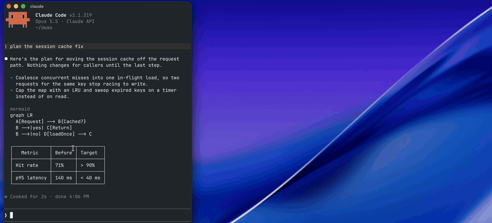

# Glimpse

**Fix broken copy-paste & render Mermaid on Claude Code / Codex WITHOUT leaving the terminal. Zero clutter.**

Copy out of Claude Code or Codex and you get a mess: broken lines and tables, raw Mermaid. Glimpse fixes it before you paste.

## How it works

Drag text in any app and press **⌘C twice**. The formatted Markdown is already on your clipboard, and a small panel shows the work:

- Broken lines → rejoined
- Box tables → real Markdown tables
- Mermaid → rendered diagram
- Clean Markdown → ready to paste

No leftover indent, no stray bullets. Code and lists keep their real line breaks. Tool calls and status lines stay out of your paste. Never drops a word.

## Install

[Download Glimpse.dmg](https://github.com/movefasttt/glimpse/releases/latest/download/Glimpse.dmg) (macOS 14 or later).

No plugin. No MCP. No config. Nothing added to your terminal.

## License

MIT
