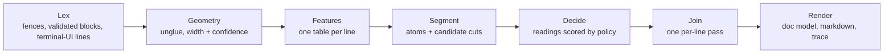

# Format engine v2 - design

Status: **ratified**, revision 3 (Darwin, 2026-10-13); **live since 2026-10-13** (see "Swap" at the end). Revision 2 folded in a cold design review; revision 3 folds in the design session with Darwin (both summarized at the end). Replaces the ordered rule cascade in `format.js` (v1). Principles: design record, "Direction after the first build".

## Why v1 has to change

v1 reached never-worse 94.0% (deleted text counted) by adding measured rules to an ordered cascade: two modes chosen by a guess (raw markdown vs terminal text), eleven classification branches whose order decides outcomes, block splits that classify before classification, and terminal-UI patterns mixed into the core. The rules interact through order, so each new rule can silently override an earlier one. The cold code review found what that produces: deleted text, a whole paste flipping to markdown on one backtick, joins on short selections.

v2 keeps v1's knowledge (each rule encodes something true about real text) and changes how decisions are made.

## The model

One pipeline. Each stage is a pure function from data to data, with its own fixtures.



1. **Lex** (deterministic, before anything is scored): normalize line endings, keep input line numbers for provenance, then mark what is certain:
   - fenced blocks, as unsplittable atoms;
   - parser-confirmed blocks: mermaid (header keyword, then `mermaid.parse`, async, run only here) and JSON;
   - terminal-UI lines, per line, from the active profile's shapes. A tool call plus its deeper-indented output, a `❯` prompt plus its padded continuation. Marked as `demote` candidates, never removed. This is what splits a spill of tool output followed by `⏺ Done.`.
2. **Geometry**: undo glued full-width rows (profile hint); estimate the wrap width **with a confidence** (definitions in `policy.js`):
   - *high*: a prompt-box border;
   - *medium*: at least 3 lines ending within 3 columns of one width, **and** terminal evidence (reply indent, profile markers, box drawing - v1's measured gate, kept);
   - *low*: anything else. Low confidence means no joins.
3. **Features**: one table of facts per line, computed once: width, indent, near-wrap-width, trailing padding, bullet marker, box characters, `Label:` shape, markdown syntax, code signals, profile shape matches. Every reading reads only this table.
4. **Segment**: atoms = blank-line runs not already claimed by Lex. Places where an atom *might* be cut (a bullet run starting, box drawing starting, a line ending in `:` followed by a code-shaped line) and places where neighbours *might* merge (a diagram's section breaks, code spanning a blank line) are produced as **candidate segmentations**, not decisions.
5. **Decide**: for each atom, every reading reports **evidence flags**; the policy turns flags into a rough likelihood per type with one shared formula; then the reading with the **lowest expected risk** wins (see Risk policy). Each candidate cut or merge is decided locally by the same rule, never searched in combination. Readings choose a *type* only.
6. **Join**: one per-line pass after types are chosen, for every joinable type (prose, list item, quote, table cell value): join only with width confidence medium or high **and** the greedy-wrap test (the next line's first word could not have fit). One place, one rule.
7. **Render**: a document model (blocks: type, content, source lines, `demoted`) rendered to markdown for the panel, plus the per-line trace.

## Readings and evidence

A reading is a small module that reports evidence; it never computes its own score:

```js
// a reading
{
  type: 'code',
  evidence(lines, features, ctx) { return { statementShape: 0.6, symbolDense: 1, prose: 0 }; },  // named flags, 0..1
  render(lines, ctx) { return { markdown: '...' }; },
}
```

The policy scores every reading the same way: `score = Σ weight[flag] × flag`, with every weight in `policy.js`. Scores are comparable because one formula and one weight table produce them all. Scores say how likely each type is; they don't pick the winner on their own (Risk policy does). Evidence prefers **validators and exact inversions** (a parser accepts it; Claude Code's known layout matches) over weights; a validator flag carries most of the score by itself.

| Reading | Main evidence |
|---|---|
| verbatim | none - the floor |
| prose | sentence shapes, low symbol density |
| list | bullet markers, hanging indents |
| table | **exact grid** (validator: every row's column separators at the same columns, every cell accounted for), `Label:` groups with separators, markdown pipes. Box characters alone are not table evidence |
| code | fence (validator), statement shapes, symbols, aligned columns, JSON (validator), **2-D layout** (box drawing, arrows or pointers placed by column) that is not an exact grid |
| diagram | mermaid parse (validator) |
| heading | markdown `#` (validator), short line without sentence punctuation followed by content |
| quote | `▎` or `>` prefix |
| terminal UI | profile shape match (from Lex) |

**Verbatim** is the floor every other reading must beat by a margin. It renders the lines exactly as they arrived, in the panel's normal font with line breaks kept (`white-space: pre-wrap`): the "worst case looks like the input" promise, visibly. Trace type `verbatim`; the scorer counts it as neither damage nor correct, so falling back shows up as lower accuracy instead of hiding.

## Two invariants

Checked mechanically on every render, not left to each reading:

1. **No word is lost.** Every word of the input appears in the output, in order (markup the reading deliberately rewrites, like `⏺` or a bullet glyph, excepted). A reading whose render fails the check is disqualified for that atom, which falls back to the next-lowest-risk reading and finally to verbatim. One check covers every way text can disappear, including bugs in readings not yet written.
2. **Geometry is content.** When meaning is carried by column position (box drawings, UI mockups, `▲` pointers, trees, aligned columns), the block is never reflowed or re-parsed. The only exception is an exact inversion: a box table whose grid validates is rebuilt as a table, losslessly. Anything else keeps its geometry and renders as code (monospace, positions untouched).

Both are validators in the same sense as `mermaid.parse`: they replace the per-case rules a cascade would grow ("don't drop the header row of a cut table", "don't join a line that holds only an arrow", "don't tabulate nested boxes").

## Risk policy

"Risk" here is the reading damage a wrong call does - never money or compute. There is no correct answer for fuzzy text, so the evidence a decision needs scales with what a wrong call destroys:

| Decision | What a wrong call does | Evidence required |
|---|---|---|
| delete | Text disappears | Not allowed (invariant 1) |
| structure → prose (code/table/diagram read as prose or list) | Lines run together, layout lost | High |
| 2-D layout → table | Drawing torn into cells, text lost | Exact grid only (invariant 2) |
| join two lines | Separate lines run together | Width confidence medium/high + greedy test |
| prose → structure (prose shown as code, a line as heading) | Right text, heavier styling | Modest |
| demote (terminal UI) | Reply text shown dimmed, still readable in place | Modest |

**The table is the mechanism, not commentary.** `policy.js` holds a small risk matrix (what showing type A costs when the truth is type B, from the classes above). Decide picks the reading with the lowest expected risk given the likelihoods. "Ties go to the cheapest mistake", the verbatim floor's margin, and the inline-markup rule below all follow from the same matrix instead of being separate thresholds.

This matches the decision already recorded ("close calls keep line breaks") and the metric (structure → prose is damage; the reverse is not).

**Terminal UI is demoted, never deleted: dimmed lines left in place** (Darwin, 2026-10-13). No chip, no click, no label to read; the reply simply reads louder than the tool output around it. Because a wrong demotion only dims text that stays readable, it is a cheap mistake and needs modest evidence, not high. Demoted lines are dimmed in the panel only; every copy keeps them as plain text, as they arrived (Darwin, 2026-10-28, reversing the earlier "left out of every copy action"). Collapsing long runs waits for a friction-log entry: real copies hold almost no terminal UI (1 line in Darwin's 39 copies; all 781 samples with terminal UI come from the two deliberately constructed spill kinds).

**Inline markup** (`**`, backticks, `<`, links) is decided per atom by the same risk rule: a literal backtick shown is cheap, eating `Vec<String>` or a line break is expensive, so markup is interpreted only when the evidence for markdown (a fence, a `#` heading or pipe table elsewhere in the text, several distinct inline signals) outweighs that asymmetry; otherwise it is escaped and shown literally.

## Source profiles

Tool knowledge lives outside the core. A profile contributes data only, through a fixed schema:

```js
{
  name: 'claude-code',
  detect(lines) { return 0.0; },          // gates every hint below
  shapes: [ /* terminal-UI line shapes -> feature columns (tool call, output, prompt, status, notice) */ ],
  hints: {
    replyIndent: 2,                        // geometry: terminal evidence
    promptBorder: true,                    // geometry: high width confidence
    langTagLine: true,                     // lex: bare `mermaid` line before a diagram
    labelTables: true,                     // table evidence: Label: value layout
  },
}
```

The core ships with `plain` (no hints) and `claude-code`. Prompt-box borders, glued rows and `Label:` tables move out of the core into the Claude Code profile. A new tool is a new profile, never core edits.

## Gates

v2 replaces v1 in the panel only when **all** of these hold. They are two-sided because a formatter that does nothing scores 100% never-worse: a stub that marks every line as code was measured at 100% on the samples and on gold, with 7.6% line accuracy and 0.7% block recovery.

| Gate | Threshold |
|---|---|
| Never-worse (samples, gold) | ≥ v1, both re-scored under the revision-3 damage definition (lost words, 2-D layout read as table) |
| Lost words | 0 on samples and gold (invariant 1) |
| Quality floors: line type accuracy, join recall, block recovery, terminal UI recognized, gold block recovery | ≥ v1 minus 1 point each |
| Held-out split (20% of sessions, never used for tuning) | v2 minus v1 never-worse on held-out, paired and resampled by session: 95% lower bound ≥ -1 point (2026-10-13; replaces "within 1 point of the tuned split", which the split's size cannot resolve). The tune gap and the other-sources set are reported |
| Adversarial checks (incl. the short-selection joins from the cold review) | All pass |
| Raw markdown | No reply shows fewer of any word than v1, and none loses the block structure v1 kept (2026-10-13; token identity is reported, not gated: the parser eating `<name>` is identical tokens and lost text) |
| Panel | 0 errors on the headless panel run |
| Latency | p99 under 50 ms on samples; pathological inputs under 500 ms (Darwin, 2026-10-13; was 100 ms) |
| Rule budget | Named weights and thresholds in `policy.js` fewer than v1's, counted the same way (v1 counted in step 1; its raw numeric literals, ~270, are not the measure) |

The scorer gains a `verbatim` type, a `demoted` flag (demoted reply text counts as a type error, not deletion), and two damage rules: any lost word, and a truth `code`/`diagram` line predicted `table` (`dataset.md` updated with them).

## Code layout

```
engine/
  00-open.js       IIFE head
  01-policy.js     every weight and threshold, named and commented
  02-profiles.js   text helpers; plain and claude-code profiles (data only)
  10-lex.js  20-geometry.js  30-features.js
  40-readings.js   validators (exact grid, Label: groups, pipe table, JSON) and readings
  50-decide.js     risk matrix, expected-risk decision, candidate cuts
  60-join.js  70-render.js  90-entry.js
format.js           `cat engine/*.js`, regenerated by build.sh - no bundler, no new toolchain
```

Each file is a section of one IIFE namespace, so the app keeps inlining a single `format.js` and `build.sh` gains one `cat`. Every decision keeps its reasons (flags and weights), so the eval report can answer "why code?" for any failure.

A classifier judge (local only; a hosted classifier would send clipboard text off the machine) can plug into close-margin decisions later. Not in v2.

## Build sequence

| Step | Who | Output |
|---|---|---|
| 1. Schemas | integrator, serially | feature table, evidence flags per reading, score formula, profile schema, trace contract (`verbatim`, `demoted`), `dataset.md` + scorer updates, held-out split |
| 2. Stages | agents in parallel, each against per-stage fixtures | lex, geometry, features, segment, join, render |
| 3. Readings + profile | agents in parallel, per-reading fixtures only | evidence functions; no tuning against the eval |
| 4. Calibration | integrator only | weights and thresholds in `policy.js`, against the tuning split |
| 5. Panel renderer for the doc model | agent, parallel with 2-4 | dimmed style for demoted lines, verbatim style |
| 6. Gates + cold review | integrator, one cold reviewer | go / no-go against the gate table |

Calibration belongs to one owner so readings can't race each other for contested samples.

## Open decisions (Darwin)

| Decision | Options | Status |
|---|---|---|
| Ratify this design | as written / with changes | **Ratified as revision 3** (Darwin, 2026-10-13) |
| Swap v2 into the live panel | after a gallery review / automatically on PASS | **Decided: automatically** when every gate passes and the cold reviewer signs off; v1 stays one `git revert` away (Darwin, 2026-10-13). **Swapped 2026-10-13** after round 7, Darwin waiving an eighth review ("let's swap finalize") |
| How demoted terminal UI looks | collapsed chip / dimmed lines left in place | **Decided: dimmed lines in place** (Darwin, 2026-10-13) |
| Covering new failures | finer rules per case / general invariants | **Decided: generality over granularity** (Darwin, 2026-10-13: "a wise move is not more granularity, but generality and simplicity that can cover many cases") |
| How the raw-markdown gate reads | token identity / no lost words or structure vs v1 | **Decided: no lost words or block structure vs v1**, plus the general fix for the two tables it exposed (Darwin, 2026-10-13) |
| Held-out gate | gap to the tuned split / paired v2-minus-v1 by session | **Decided: paired, session bootstrap, lower bound ≥ -1** (Darwin, 2026-10-13) |
| Glued PR tables with no fixed period | hold the swap / ship and fix next | **Decided: ship; next engine task** (Darwin, 2026-10-13: "we don't aim for perfection. but we for sure will avoid stitch-and-fixing"). **Fixed the same day** by one general rule ("Glued rows" below) |
| Script in three v2-only markdown triggers | sanitize / align v2's evidence with v1's | **Decided: align**, no sanitizer (Darwin, 2026-10-13; sanitization ruled out 2026-10-12) |
| Pathological-input latency limit | 100 ms / looser | **Decided: 500 ms** (Darwin, 2026-10-13); p99 on samples stays under 50 ms |

## Review summary (revision 1 → 2)

| Finding | Change |
|---|---|
| Gates passed a do-nothing formatter | Quality floors, held-out split, latency, rule budget |
| Verbatim undefined | Rendering, trace type, scorer treatment defined |
| Cost per reading, joins inside list/quote/table ungated | Joins are one per-line pass for every joinable type |
| Restyle cost ignored the code-vs-prose asymmetry | Split into structure → prose (high) and prose → structure (modest) |
| Segmentation still classified first; merges unresolved | Fences and validators lexed first; cuts and merges are scored candidates |
| Mode flip moved to inline markup | Per-atom inline policy; inline check in the raw-markdown gate |
| Terminal-evidence join gate dropped | Kept, as part of medium width confidence; "several" defined |
| Scores as the new overfit surface | One formula, all weights in `policy.js`, validators first, rule budget gate, held-out split |
| Demote contract open | Trace flag, scorer rule, copy exclusion, renderer track |
| Profiles decided things; Claude specifics in core | Data-only profile schema; Claude geometry moved into the profile |
| Tracks not independent | Schemas serial first; calibration by one owner; async validators only in Lex |
| YAGNI | Judge cut to one sentence; no bundler; seven stage files instead of seventeen modules |

## Design session (revision 2 → 3)

| Finding | Change |
|---|---|
| Decide picked the highest score, so the cost table was prose, not mechanism | Lowest expected risk over a risk matrix in `policy.js`; "cost" renamed "risk" (it never meant money) |
| Candidate segmentations × readings could explode | Each cut or merge decided locally by the same rule |
| Rule-budget gate had no counting method | Named weights and thresholds, counted the same way for v1 |
| Chip hid misread reply text, forcing a high demote bar | Dimmed lines in place; demote bar drops to modest |
| A real copy of Claude Code UI mockups (nested boxes, side-by-side boxes) was rebuilt as markdown tables and lost 6 phrases (`Note for Loom`, `…ledger…`, `General notes`...) (corpus `2026-10-13T180557-copy`); a sibling copy had a `▲` pointer joined onto the line above (`2026-10-13T175422-copy`); a cut table lost its header row (gold `T231030`). The scorer saw none of it as damage | Two invariants (no lost word, geometry is content); table evidence becomes an exact-grid validator; scorer counts lost words and 2-D layout read as table |

## Build (2026-10-13)

Built beside v1 in one session: engine by the integrator; gate tooling (`research/dataset/gates.mjs`, `split.mjs`, `rawmd-gate.mjs`, `rule-budget.mjs`), the regression set (`research/other/regress/`, 21 cases incl. Darwin's three broken copies) plus a v1-vs-v2 gallery (`research/gallery/build.mjs`), and the panel styles for verbatim and demoted lines, by three parallel agents.

**Decisions made while building** (each forced by a measured failure, each general):

| Decision | Forced by |
|---|---|
| Candidate cuts only at the three shapes this doc names (bullet run, box drawing starting or ending, `:` then code) | Cutting wherever the line class changed tore partial diagrams into prose and headings (gold never-worse 82%) |
| Structure-as-prose risk scales with the share of lines that have a break before them; a one-line atom's two mistakes are symmetric | `**Caveats:**` and other one-line lead-ins read as code |
| **Markdown reading**: in text with strong markdown evidence, an atom with no terminal-only shapes renders as its source - markdown's own syntax is the exact inversion | Raw markdown 780/1,706 identical when markdown was re-derived with terminal heuristics |
| In text the Claude Code profile claims, fences and markdown-looking lines are content, never markdown evidence (its terminal strips all markdown) | A README shown in the terminal: its literal ``` lines swallowed 200 lines of prose as code |
| Inline spans (bold, code, link, emphasis, strikethrough) are always kept; everything else is escaped; line structure comes only from Join | The v1 failure was a single backtick flipping the whole paste into markdown mode; interpreting the span itself is nearly free |
| Validator weight 12: validators dominate heuristic code evidence | Pipe tables shown as code |
| The exact grid accepts a first or last row and border cut by the selection | Real copies end mid-table; a strict grid sent them to code |
| Diagram merge: one candidate (v1's diagram-body shape), at most two parses | Up to 330 ms per sample in repeated mermaid parses |
| Width confidence needs 1 line near the width, not 3 | Measured: 2 lines drops join recall 97.1 → 91.7 and gold 100 → 81.1 with never-worse unchanged. Consequence: the cold review's short-selection join still happens when the text has terminal evidence (plain text keeps its breaks) |
| A line of only drawing characters (no letters or digits) is code evidence: it has no words to be prose | The stray `└──┴──┘` edge of a table at the top of a selection rendered as wrapped prose rules |
| Exact grids are carved out in Lex, like fences and diagrams | With drawing evidence, a real copy's validated table inside a heading-and-list atom pulled the whole atom to code |
| `trimEnd()`, never `\s+$` | Quadratic on lines of leading whitespace (v1: 280 ms on deeply indented code; v2: 30 ms) |

**Cold review round 1: FAIL** (one reviewer, reproduced every gate number). The no-lost-word invariant and the scorer both checked the markdown *source*, so text marked eats was invisible: a doubly escaped `|` dropped table cells (a real copy lost "~4 lines"), kept bold/emphasis spans let `<Widget>` / `Vec<String>` through as HTML, a multi-line atom starting with `#` rendered one line (the distinct-word check hid the duplicate). Fixed at the cause, generally:

| Fix | Covers |
|---|---|
| Invariant 1 runs on **rendered text** (`opts.renderText`: marked + inert `DOMParser` in the panel, marked + tag strip in the scorer), counting words, not distinct words; the markdown reading must pass it too | Every way the parser eats text, including readings not yet written; v1's honest count rises to 56 samples |
| Cells escaped once; text inside kept spans is HTML-escaped | The two repros |
| Heading reading is one line only; `#` is markdown only outside terminal text | The dropped line |
| One definition of terminal evidence (profile marks, wholly indented text, box drawing): in it, fences, markdown syntax and inline spans are content and escaped | A literal `[MMP-937](url)` in a terminal copy rendered as a link, hiding its URL |
| Claude Code specifics (`▎`, `⏺`, label tables) read from the profile, not the stages | Reviewer's design-adherence findings |
| Glued rows: a box line wider than the terminal width (widest width seen twice) is cut into terminal-width pieces, only if every piece after the first starts a box row | One of five glued PR-table copies now renders as a table; the rest stay monospace with every word (residual below) |

**Gates after round 1 fixes** (`node gates.mjs <v1> <v2>`; v1 re-scored under the same rendered-text rules):

| Gate | v1 | v2 | Result |
|---|---|---|---|
| Never-worse, tune / held-out / gold | 93.0 / 92.9 / 97.4 | 94.5 / 93.7 / 100 | PASS |
| Lost words, rendered (samples with any) | 56 | 0 | PASS |
| Floors (tune): line type, join recall, block recovery, terminal UI; gold block recovery | 92.8, 97.1, 90.2, 93.3; 79.2 | 93.1, 97.1, 91.1, 93.1; 80.2 | PASS |
| Held-out within 1 point of tune | -0.1 | -0.8 | PASS |
| Adversarial checks; regression set | 12/12; 12/21 | 12/12; 21/21 | PASS |
| Raw markdown, block + inline identical | 1,697 / 1,706 | 1,701 / 1,706 (blocks 1,706) | PASS |
| Panel errors (100 inputs) | 0 | 0 | PASS |
| Latency p99; worst pathological | 23 ms; 280 ms | 7 ms; 58 ms | PASS |
| Rule budget: named tunables | 51 (v1 literal method) | 50 in `policy.js` (more by the literal method, which also counts structural "at least two" constants) | PASS on tunables |

**Cold review round 2: FAIL.** Gates passed but scored with a different notion of "shown" than the panel (the panel's DOM text glued `a<br>b` into `ab`, so v2's hard breaks failed the word check in the panel only and good lists fell to verbatim); a pipe table in terminal text rendered raw (ate `<String>`, ran an ``); candidate cuts were cubic (`tree` output 3.3 s, 2,000 alternating lines 30 s); fences and the assembled document were never checked (an unclosed `<!--` swallowed the rest); a table whose cut first row starts at a bar fell to code. Fixed:

| Fix | Covers |
|---|---|
| **One renderer**: callers pass only `toHtml` (marked); the engine derives shown text itself (tags become spaces, entities decode) and the scorer uses the same definition | Panel and gates can no longer disagree |
| Pipe tables are markdown, so content in terminal text | Script and text loss through a pipe table in a Claude Code copy |
| Cuts: split at every candidate, merge neighbours that read the same type; an atom whose whole validates (grid, label table, pipe table) is never cut | Linear time (worst cases 10-33 ms); a selection-cut first row stays in its table |
| Invariant 1 on the whole document: if a shown word is missing, render again with markdown off (fences and syntax are text, everything escaped) | Unclosed comments, fences that swallow, and any block that eats its neighbours |
| The grid's first row may have fewer cells (cut by the selection), wherever it starts | Real copies that fell to code |
| Claude Code's bare `mermaid` line over a diagram header is a profile shape (detection), not a core rule; the wrap test reads the quote marker from the profile; the truncated-first-line join needs width confidence; `ruleMin` and the prompt padding slack are read from policy | Design-adherence findings |

**Honest note on width confidence**: with the measured `minNear: 1`, "medium" confidence is effectively "the text has terminal evidence" - the widest line always counts as near the width. Revision 3's "several lines near one width" test did not survive measurement (2 lines: join recall 97.1 → 91.7, gold 100 → 81.1). Joins in text from other apps happen only when it carries terminal evidence; a plain text whose first line is less indented than the rest reads as a truncated selection and joins (v1 does the same; round 7).

**Cold review round 3: FAIL (one blocking).** In raw markdown, a fence's language word lives only in an HTML attribute, so the whole-document check counted it lost and switched markdown off for the whole paste (all 119 replies with a tagged fence broke) - v1's "one token flips the paste", inverted. The gates missed it because four harnesses ran without `toHtml`. Fixed: a fence's info string is consumed metadata (like the bare `mermaid` tag) and an HTML element's tag is markup, so neither is a needed word; a link's destination counts as shown (it is the link), replacing a loose exclusion the reviewer used to smuggle script; comments are hidden whole; markdown-off really escapes headings and pipe tables; **every harness runs in the panel's configuration**.

**Gates in the panel's configuration** (after round 3, load average 9.7):

| Gate | v1 | v2 | Result |
|---|---|---|---|
| Never-worse, tune / held-out / gold | 93.0 / 92.9 / 97.4 | 94.7 / 94.1 / 100 | PASS |
| Lost words, as shown (samples with any) | 56 | 0 | PASS |
| Floors (tune): line type, join recall, block recovery, terminal UI; gold block recovery | 92.8, 97.1, 90.2, 93.3; 79.2 | 93.0, 97.1, 91.4, 93.1; 80.2 | PASS |
| Held-out within 1 point of tune | -0.1 | -0.6 | PASS |
| Adversarial; regression set | 12/12; 12/21 | 12/12; 21/21 | PASS |
| Raw markdown, block + inline identical to the source | 1,697 | 1,695 | **FAIL by definition** (below) |
| Panel errors | 0 | 0 | PASS |
| Latency p99; worst pathological | 6.5 ms; 206 ms | 7.6 ms; 90.5 ms | PASS (pathological near its limit: the extra render) |
| Named tunables | 51 | 50 | PASS |

**The raw-markdown gate measures identity, not readability.** Every one of v2's eight v2-only differences shows the same or more words than v1; v1 shows nothing v2 hides. Six are placeholders like `<url>`, `<name>`, `<ts>` that marked eats as HTML (v2 keeps the block's text, so its tokens differ); one is `~121s ... (~77s` that v1's render strikes through; one is a local image link shown as text. Proposed: restate the gate as "no reply loses shown words or block structure versus v1" (Darwin's call).

**Cold review round 4: FAIL (one blocking).** Three narrow places where v2 parsed text as markdown that v1 kept as text, so raw HTML in it ran: strikethrough counted as markdown evidence, an indented `#` line counted as a heading, and an unclosed fence hid the `⏺` marks after it (terminal evidence). Non-blocking: an unclosed `<!--` still hid the rest; a pipe table holding a `<placeholder>` fell to verbatim (structure lost, the raw-markdown gate's real cost); a quadratic tag scan (963 ms on `<b ` x 20,000); a super-linear merge in cuts; the regression set's timing check disabled by a stray comment. Fixed, each by removing an exception rather than adding a rule:

| Fix | Covers |
|---|---|
| Markdown evidence is v1's (bold, code, link, a `#` heading at column 0, a pipe table, a fence); terminal marks are read outside closed fences only - an unclosed fence proves nothing about the lines after it | v2 parses as markdown only text v1 also parsed (all three triggers; adversarial cases added, failing on the round-3 engine) |
| Every reading escapes its text; only the markdown-source reading hands syntax to the parser. The pipe-table reading now escapes its cells like the grid reading, and a `#` heading escapes its text | The placeholder table stays a table with `<name>` shown; no raw path outside the markdown reading |
| Shown text: an unclosed comment hides to the end; an image's source and alt text count as shown, like a link's destination | The document check catches the unclosed comment; a markdown image renders as in v1 |
| A tag never spans another `<`; merges append in place | 963 ms → 12 ms; 20k lines 204 → 94 ms |

**Gates after round 4 fixes** (panel configuration, load average up to 58; restated gates per "Open decisions"):

| Gate | v1 | v2 | Result |
|---|---|---|---|
| Never-worse, tune / held-out / gold | 93.0 / 92.9 / 97.4 | 94.7 / 94.1 / 100 | PASS |
| Lost words, as shown (samples with any) | 56 | 0 | PASS |
| Floors (tune): line type, join recall, block recovery, terminal UI; gold block recovery | 92.8, 97.1, 90.2, 93.3; 79.2 | 93.0, 97.1, 91.4, 93.3; 80.2 | PASS |
| Held-out, v2 minus v1 never-worse (14 sessions, 95% session bootstrap) | - | +1.3 [0.0, +3.0] | PASS |
| Adversarial; regression set | 16/17; 12/21 | 17/17; 21/21 | PASS |
| Raw markdown, replies losing words or block structure vs v1 | - | 0 / 1,706 | PASS (token identity, reported: 1,697 v1, 1,696 v2) |
| Panel errors | 0 | 0 | PASS |
| Latency p99; worst pathological | 6.9 ms; 208 ms | 7.4 ms; 94.8 ms | PASS (pathological near its limit under load) |
| Named tunables | 51 | 50 | PASS |

The new raw-markdown gate fails when it should: with v2 as the baseline and v1 as the candidate it flags 7 replies (v1 loses `<name>`, `<url>`, `<ts>` and the image text). Not addressed, reported: the markdown-off fallback (pass 3) costs about 240 ms on a 10k-line paste and the pathological set doesn't cover it; the entry's content filter names `⏺` (a profile shape) directly.

**Cold review round 5: FAIL (three blocking).**
1. A `~~~ text` line lost its words. v2 counted `~~~` fences and `\s`-indented syntax as markdown evidence where v1 does not, and the word check excluded everything after a fence marker.
2. The code-block merge was quadratic: 3,000 blank-separated code lines took 916 ms.
3. A `└──` pointer line under code was torn out into a paragraph, a geometry-invariant case v1 got right.

Non-blocking: no gate checks join precision, so a join-everything mutant passed every gate. Fixed, again by aligning or enforcing rather than adding rules:

| Fix | Covers |
|---|---|
| Fences and evidence are v1's exact patterns: backtick fences only, `[ \t]` indents; a fence's info string is consumed only when it is one word; kept inline spans are v1's set (no strikethrough) | `~~~` lines keep their words; the "markdown only where v1 parsed markdown" property holds for fences, NBSP-indented headings and pipe tables |
| Invariant 2 enforced like invariant 1: a part with a line that starts with drawing (box characters, a vertical pointer) cannot take a prose reading; adjacent code parts merge back | The pointer stays in its code block, in its column |
| Code merge finds runs first and fences each run once | 3,000 lines: 916 ms → 17 ms (now in the pathological set) |
| Join precision added to the quality floors | A join-everything formatter now fails a gate |

A first version put the invariant-2 filter inside the decision that cuts also use to merge parts. That tore one held-out diagram whose middle row starts with a word, between rows that start with box characters (held-out 94.1 → 93.6). The filter belongs where invariant 1 is enforced, on the final part. Held-out is back to 94.1.

**Gates after round 5 fixes** (load average 9-22): never-worse 94.7 / 94.1 / 100 against v1's 93.0 / 92.9 / 97.4; lost words 0; floors pass (join precision 99.8 against 99.7); held-out v2 minus v1 +1.3 [0.0, +3.0]; adversarial 23/23; regression set 21/21; raw markdown 0 / 1,706 worse; panel errors 0; p99 7.4 ms, worst pathological 93.9 ms (10k lines of prose); 50 named tunables. GO.

Still open, non-blocking:
- Equal-width side-by-side boxes and nested boxes are cut row by row. Every word is kept and the result shows as code; v1 is no better (it makes them a table).
- The rule budget counts v2 by its policy and v1 by its literals. Counted by v1's literal method, v2 has 64.
- A short terminal selection whose widest line is a tree line joins (the `minNear: 1` note above).
- A repeated label inside one Label: group overwrites the first.
- A 387 KB single paragraph full of links takes 848 ms (marked's inline lexer, run by the checks).
- Markdown atoms with entities fall back to one code block.

**Cold review round 6: FAIL (two blocking).**
1. A `\` inside a kept bold, emphasis or link span became a live element and its words vanished. v2's text readings kept inline spans, a second markdown surface v1 never had: v1's text mode escapes everything. Plain text with only `*emphasis*` also rendered italic where v1 kept it literal.
2. A caret line (`~^~`) under code was reflowed into prose. The round-5 geometry check was a glyph list.

Rounds 4-6 all failed in one family: v2 interpreting markup or reflowing layout where v1 did not. So this round changed the premise instead of patching:

| Fix | Covers |
|---|---|
| **Markdown is interpreted only where v1 interprets it.** Evidence is v1's exact trigger: a fence, a `#` heading, a pipe table, or any one inline span; v2's stricter two-signal threshold and its tunable are gone. Every other reading escapes all of its text, with no kept spans. HTML tags count as markup in the word check only where the markdown went to the parser as written | Spans can't smuggle tags; emphasis-only text stays literal; replies with a single `**bold**` render as markdown again (210 raw replies had fallen to literal `**` under the first try, which kept the two-signal threshold) |
| **Geometry evidence is placement, not glyphs.** A line is drawn when it starts with drawing, or has no letter or digit and sits deeper than the line above. Its part takes only monospace (structure) readings | Carets, pointers and rulers under code keep their column. A first try ("no letter or digit" alone) caught soft-wrapped `.` remainders and cost 1.4 points of join recall. Placement separates them: a wrapped remainder sits at the text's own column |
| Fence lookup indexed by first line; the document check counts distinct words, as the scorer does | 8k fences 214 → 66 ms; a Label: table no longer forces all three passes |

**Gates after round 6 fixes** (load average 8-37): never-worse 94.7 / 94.1 / 100; lost words 0; floors pass (line type 93.1, join precision 99.8, join recall 97.1); held-out v2 minus v1 +1.3 [0.0, +3.0]; adversarial 28/28 (the 5 new cases fail on the round-5 engine); regression set 21/21; raw markdown 0 / 1,706 worse (token identity, reported: v1 1,697, v2 1,692); panel errors 0; p99 6.5 ms, worst pathological 95.4 ms (10k lines of prose, measured while load climbed to 37; the margin is thin); 49 named tunables. GO.

Still open, non-blocking (round 6):
- Raw-markdown sub-selections whose first line is less indented than the rest are read as terminal text: 8 of 893 cut selections are worse than v1, and 8 are better.
- The pass-3 result is returned even if it still fails the document check: the floor of the document invariant is "markdown off", not a proof.

**Cold review round 7: FAIL (two narrow blocking).** (1) A fence closed by four backticks hid the terminal marks inside it from v2's terminal-evidence scan, where v1 only closes on exactly three, so `` ran in v2 only (no fence of 4+ backticks exists in the corpus, samples or gold). (2) A 10k-line Claude Code reply took 136-141 ms; the pathological set held only the plain-text form. Fixed:

| Fix | Covers |
|---|---|
| The terminal-evidence scan uses v1's own fence pairing (opening ``` to the next line that is exactly ```); rendering keeps CommonMark fences | The last known trigger where v2 parsed markdown that v1 kept as text |
| The rendered document check runs only when some block handed its syntax to the parser (markdown source or a fence). Every other reading escapes all of its text, now including line-start syntax (`2.`, `-`, `+`, an `=`/`-` underline) | A 10k-line Claude reply: ~140 → 94 ms (now in the pathological set). Skipping the check before line-start escaping existed showed it was needed: a quoted `2. The ...` line became list numbering and the gate caught one lost word |

**Gates after round 7 fixes** (load average 20-33): never-worse 94.7 / 94.1 / 100; lost words 0; floors pass (block recovery 91.2, gold block recovery 79.2, equal to v1); held-out v2 minus v1 +1.3 [0.0, +3.0]; adversarial 29/29; regression set 21/21; raw markdown 0 / 1,706 worse; panel errors 0; p99 7.1 ms, worst pathological 94.3 ms (the 10k-line Claude reply; thin margin); 49 named tunables. GO.

Gold block recovery fell 80.2 → 79.2 with line-start escaping, on one block of one copy. A glued copy put a short heading line and a `- item` line into one part that the engine read as a paragraph. Before, the unescaped `- ` let the parser turn the second line into a list anyway, the engine's paragraph decision overruled by accident, and the scorer counted the list as recovered. Now the paragraph shows as decided, with every word and the dash kept. The real miss is the reading (no cut between the heading line and the bullet); v1 scores the same 79.2.

**Glued rows (fixed after the swap, 2026-10-13).** The "no fixed period" diagnosis was wrong: the period was there, measured wrong. A terminal copy joins a full-width row with the next, so rows in a glued line start exactly one terminal width T apart, but copy trims the padding, so T is never a line width, and the old estimate ("widest width seen twice") found the row width instead. One rule replaces both earlier unglue passes and their profile gate: **T is measured from the glue itself**, the gap between two row starts that is at least the table's row width (read from a border, glued or not). Each restored row keeps the table's indent (no more than unglued rows show, nor than the spaces before a row start), and the cut stays exact or nothing. It now runs on text from any source, since glued box rows are their own evidence. Result: all five PR copies render as tables (one selection-cut top border stays a code line above its table; one copy turned out to be markdown, not glue, and was already a table), gold block recovery 79.2 → 80.2, a profile hint and a tunable gone (48 named). Gates GO.

**Glued rows, one row model (2026-10-22).** Superseded the rule above: one estimator for box and text rows, rows carried on from the previous content's end column, the selection's first and last row may be partial; table cuts apply in Lex, text cuts are offered to the diagram parser only (a glued text row is indistinguishable from aligned columns). Record: design.md Decisions and friction log 2026-10-22.

**The held-out gap gate cannot resolve 1 point.** Resampling by session (the split's unit; 14 held-out sessions) gives a 95% interval for the gap of [-7.2, +4.5] (cold reviewer). The informative number is the paired v2-minus-v1 never-worse difference resampled by session; at review round 1 it was +0.97 [+0.09, +2.0] on all samples and +0.52 [-0.5, +1.8] on held-out. Proposed: restate this gate as that paired check. Samples cluster by reply (up to ~12 samples each): held-out is 96 replies. Damaged replies on held-out: v1 21, v2 18 (v2 fixes 4, breaks 1); on tune: v1 36, v2 28. A reply-cluster bootstrap puts the v2 gap's 95% interval at [-5.1, +2.8]. Caveat on cleanliness: calibration during the build was scored on all samples before the split existed, so held-out is not strictly untouched (that would flatter held-out, not penalize it).

## Swap (2026-10-13)

v2 replaced v1 in the panel after seven cold-review rounds; Darwin waived an eighth. `format.js` is now the engine bundle (`build.sh` runs `cat engine/*.js > format.js`); v1 lives on as the gates' baseline in `research/baseline/format-v1.js` (`node gates.mjs ../baseline/format-v1.js ../../format.js`). Gates at the swap, in the panel's configuration: never-worse 94.7 / 94.1 / 100 (v1 93.0 / 92.9 / 97.4); lost words 0 (v1 56 samples); floors pass; held-out v2 minus v1 +1.3 [0.0, +3.0]; adversarial 29/29; regression set 21/21; raw markdown 0 / 1,706 worse; panel errors 0; p99 7.2 ms, worst pathological 91.6 ms (limit 500 ms); 49 named tunables against v1's 51. Rollback: revert the swap commit, then `./build.sh`.

Known gaps carried into use, each a friction-log candidate rather than a case rule:
- A glued heading line and a following bullet read as one paragraph (one gold block).
- Four-backtick fences quoting Claude transcripts are read as terminal text, as in v1.
- Equal-width side-by-side boxes and nested boxes are cut row by row.
- Short terminal selections whose widest line is a tree line join.
- Raw-markdown selections that start mid-reply with a shallower first line are read as terminal text.
- The entry still names `⏺` directly.
- Markdown atoms with entities fall back to code.

